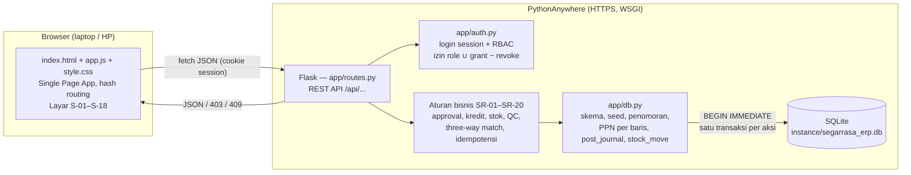
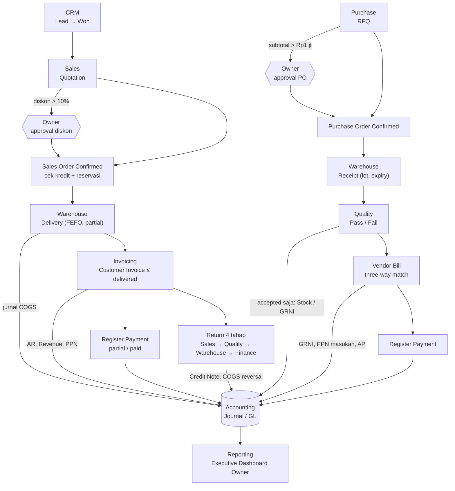
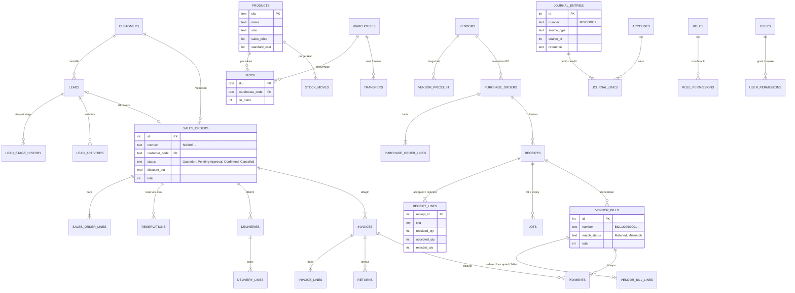

# Diagram Arsitektur dan Data — SegarRasa ERP

**Group 01 · 24SI3 · Food & Beverage**

Diagram ditulis dalam Mermaid sehingga tampil langsung sebagai gambar di GitHub.

## 1. Arsitektur sistem

Setiap request tulis melewati tiga pemeriksaan berurutan: (1) siapa user dan apakah masih aktif, (2) apakah role/levelnya punya izin, (3) apakah aturan bisnis terpenuhi. Hanya bila ketiganya lolos, perubahan dokumen, stok, dan jurnal disimpan sekaligus dalam satu transaksi. Tombol yang disembunyikan di tampilan hanyalah kenyamanan; penegakan aturan tetap di server.

## 2. Peta modul dan alur antar-modul

## 3. Diagram data (entitas inti)

## 4. Aturan desain data

- **Uang** disimpan sebagai integer rupiah; PPN efektif 11% (12% × 11/12) dihitung per baris dengan pembulatan half-up (SR-14).
- **Variant SKU** adalah record produk terpisah (SR-17); stok dicatat per SKU per lokasi.
- **Available** tidak disimpan, tetapi dihitung: On Hand − Reserved aktif (SR-03/SR-04).
- **Penomoran** diambil dari tabel `sequences` di dalam transaksi yang sama dengan pembuatan dokumen; kolom nomor bersifat UNIQUE (SR-15).
- **Jejak audit**: `audit_logs` mencatat actor, waktu, aksi, nomor dokumen, dan rincian; percobaan yang ditolak juga dicatat. Perubahan stage lead disimpan di `lead_stage_history`.
- **Status sebagai pengunci idempotensi**: delivery, receipt, invoice, bill, transfer, dan retur hanya diproses bila statusnya masih sesuai (update bersyarat), sehingga klik ulang tidak membuat stock move atau jurnal kedua.
- **Baseline seed**: 749 unit stok (WH-PKU 596, OUT-MRP 153), reserved 10 pada S00004, saldo awal AR Rp1.050.000, AP Rp220.000, Bank Rp7.000.000, Inventory Rp6.314.000.

## 5. Chart of accounts

| Kode | Akun | Dipakai oleh |
|---|---|---|
| 1010 | Bank | Pembayaran customer dan vendor |
| 1020 | Cash on Hand | Saldo awal |
| 1100 | Accounts Receivable | Invoice, pembayaran, credit note |
| 1200 | Stock Valuation | Receipt, delivery, retur saleable, selisih harga beli |
| 1210 | Stock Interim Received / GRNI | Receipt dan vendor bill |
| 1300 | VAT Input | Vendor bill |
| 2100 | Accounts Payable | Vendor bill dan pembayaran vendor |
| 2200 | VAT Output | Invoice dan credit note |
| 3100 | Opening Equity | Jurnal saldo awal |
| 4100 | Sales Revenue | Invoice dan credit note |
| 4110 | Sales Discounts | Diskon pada invoice |
| 5100 | Cost of Goods Sold | Delivery dan pembalikan saat retur |
| 6100 | Quality Loss | Retur Damaged |
| 6200 | Shipping Expense | Disiapkan untuk biaya kirim |
| 6300 | Bank Charges | Disiapkan untuk biaya bank |
